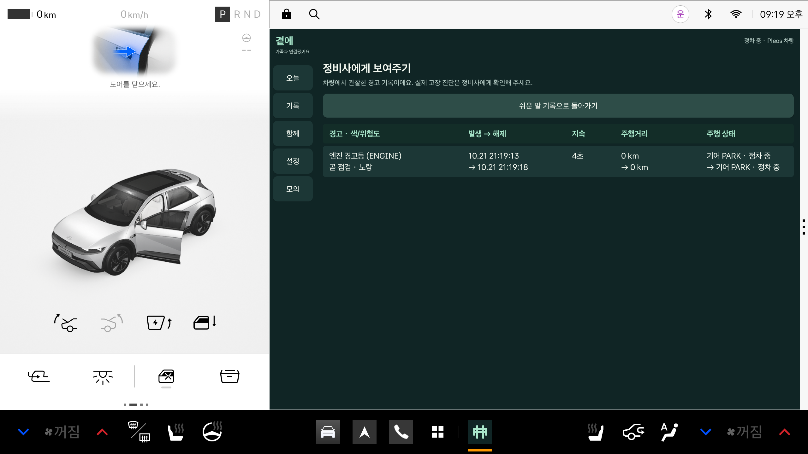
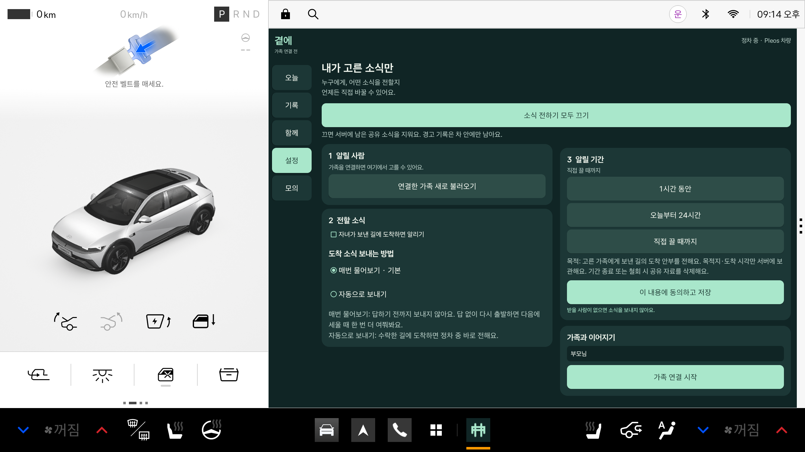
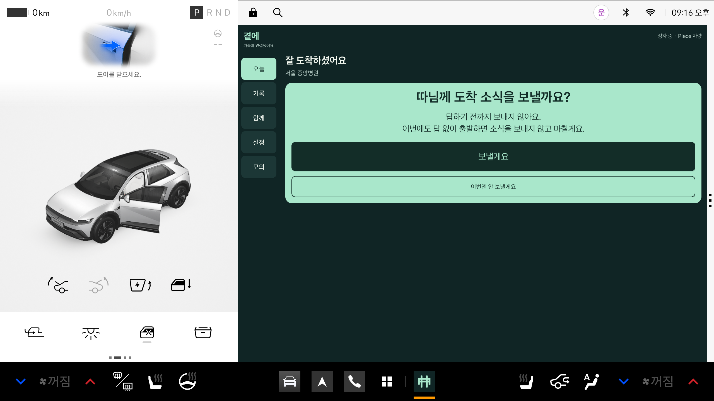

# 곁에 (가제)

부모님 차가 경고등을 쉬운 말로 풀어 주고, 부모가 직접 허락한 소식만 자녀에게 전하는 Pleos 차량용 앱입니다.

> 2026 Pleos 앱 개발 챌린지 출품작 저장소입니다. 앱 이름 「곁에」는 가제이며 상표·앱마켓 중복 검색은 아직 하지 않았습니다.

## 핵심 기능 2개

1. **경고등 기록 + 정비사에게 보여주기** — 차가 알린 경고등을 쉬운 말로 설명하고, 언제 켜졌다 꺼졌는지(시각·거리·기어)를 차 안에 기록합니다. 정비소에서는 표 화면으로 바꿔 그대로 보여 줄 수 있습니다.
2. **자녀가 보낸 목적지에 도착했을 때만 소식 보내기** — 자녀가 웹에서 목적지를 보내면 부모가 차에서 수락하고, 도착하면 차가 "따님께 도착 소식을 보낼까요?"라고 묻습니다. 보내는 사람은 항상 부모입니다. 기본은 '매번 물어보기'이고, 답이 없으면 보내지 않고 다음 정차 때 한 번 더 묻습니다.

## 5분 시연 흐름

1. 서버를 켠다 → 자녀용 웹(`/child/`)에서 가족 연결 번호 6자리를 입력한다.
2. 차(앱)에서 알릴 사람과 "자녀가 보낸 길에 도착하면 알리기"를 켜고 **동의하고 저장**한다.
3. 자녀가 웹에서 목적지를 보낸다 → 차에서 수락한다.
4. 도착(기어 P + 문 열림)하면 "따님께 도착 소식을 보낼까요?" 카드가 뜬다 → **보낼게요** → 자녀 화면에 도착 소식이 나타난다.
5. 경고등을 켜 본다 → 쉬운 말 설명 → **정비사에게 보여주기** 표.
6. 설정에서 **모두 끄기** → 서버 동의 off와 공유 데이터 삭제, 이후 전송 0건.

## 화면

가로 2560×1440 에뮬레이터 캡처입니다.

| 도착 소식 묻기 | 정비사에게 보여주기 |
|---|---|
|  |  |
| **설정(동의)** | **무응답 후 다음 정차 재질문** |
|  |  |

자녀용 웹(폭 390px) 캡처는 [server/docs/screens/](server/docs/screens/)에 있습니다.

## 구성

| 폴더 | 내용 |
|---|---|
| `app/` | Kotlin Android 앱 (패키지 `ai.gyeote.app`, 최소 Android 28). 설명·검증: [app/docs/README.md](app/docs/README.md) |
| `server/` | Node.js 데모 서버 + 자녀용 웹 (외부 패키지 없음, Node 20+). 설명: [server/README.md](server/README.md) |
| `docs/` | 결정 기록 [decisions.md](docs/decisions.md), API 계약 [api_contract.md](docs/api_contract.md), SDK 메모 [pleos_sdk_notes.md](docs/pleos_sdk_notes.md), 개발 환경 [dev_env.md](docs/dev_env.md), 공개 전 감사 [repo_audit.md](docs/repo_audit.md) |
| `research/` | 공모전 규정·시장·선행 사례·SDK 가능성 조사 ([규정 요약](research/00_contest_rules.md)) |

## 쓰인 Pleos SDK와 실측 제약

- Vehicle 2.3.2(경고등·기어·문·거리), NaviHelper 3.0.5(길안내 요청·도착), 음성 SDK 3.3.1(on-device 확인용). 공식 Maven에서 받으며 **SDK 파일·API 원문은 이 저장소에 복사하지 않았습니다.**
- 에뮬레이터 이미지 v2.1.0(API 34)에서 확인했습니다. 실제 차량·백그라운드 서비스는 검증 범위 밖입니다.
- `PRIVATE_CAR_SAFETY` 권한은 앱마켓 사전 승인이 필요해 **debug 빌드에만** 선언했습니다. release는 공개 조회(3초 간격)만 쓰고 비공개 수치 API를 호출하지 않습니다.
- 에뮬레이터 2.1.0의 타이어 수치는 `ERROR_NOT_SUPPORTED_PROPERTY`여서 수신했다고 표시하지 않습니다.
- 주행 중에는 입력 없는 큰 문장 카드만 표시합니다. 이는 주행 허용 심사를 받았다는 뜻이 아닙니다.

## 실행 방법

준비물: Node 20+, JDK 21, Android SDK(`local.properties`에 `sdk.dir`), Pleos 에뮬레이터. PowerShell 기준.

**서버**
```powershell
node server/src/index.js                 # http://localhost:8787, 자녀용 웹은 /child/
node server/scripts/demo-car.js          # 차 역할 흉내(서버가 켜져 있어야 함)
```

**앱 빌드·설치** (에뮬레이터 `emulator-5554`가 켜져 있어야 함)
```powershell
$env:JAVA_HOME = 'C:\Program Files\Android\Android Studio\jbr'
.\gradlew.bat test assembleDebug assembleRelease lintDebug --console=plain
& "$env:LOCALAPPDATA\Android\Sdk\platform-tools\adb.exe" -s emulator-5554 install -r app/build/outputs/apk/debug/app-debug.apk
& "$env:LOCALAPPDATA\Android\Sdk\platform-tools\adb.exe" -s emulator-5554 shell am start -n ai.gyeote.app/.MainActivity
```

앱은 개발 빌드에서 `http://10.0.2.2:8787`(PC의 서버)에 연결합니다. 모의 콘솔 사용법은 [app/docs/README.md](app/docs/README.md)를 보세요.

## 테스트

```powershell
node --test server/test                  # 서버 계약 테스트
.\gradlew.bat test --console=plain       # 앱 단위 테스트 (Debug·Release)
```

| 대상 | 최근 결과 | 근거 |
|---|---|---|
| 앱 단위 테스트 | Debug 173 + Release 173 = 346건, 실패 0 (2026-10-22) | [VERIFICATION_polish.md](app/docs/VERIFICATION_polish.md) |
| 서버 계약 테스트 | 48건 통과, 실패 0 (2026-10-22, `node --test server/test`) | [VERIFICATION_v03.md](server/docs/VERIFICATION_v03.md)(작성 당시 31건) |
| 실제 에뮬레이터 통합 | 13/13 (서버 직접 연결, 모두 끄기 포함) | [VERIFICATION_polish.md](app/docs/VERIFICATION_polish.md) |

이전 단계 검증: [VERIFICATION.md](app/docs/VERIFICATION.md), [VERIFICATION_car.md](app/docs/VERIFICATION_car.md), [VERIFICATION_edge.md](app/docs/VERIFICATION_edge.md). 에뮬레이터가 필요한 통합·캡처 도구(`app/tools/*.py`)는 해당 문서의 명령을 따릅니다.

## 개인정보 원칙

- 모든 공유는 **기본 꺼짐**이며, 부모가 고른 소식만 부모가 고른 사람에게 갑니다.
- 경고 기록은 **차 안(앱의 암호화 저장소)에만** 남고 서버로 보내지 않습니다.
- 동의를 줄이거나 끄면 즉시 전송을 멈추고 서버의 공유 데이터를 삭제합니다. 서버도 동의 없는 이벤트는 거절합니다(403).
- 좌표·음성 메시지·타이어 수치 코드는 기능 스위치 뒤에 숨겨 두었고 기본으로 쓰지 않습니다.
- 데모 서버는 시연용입니다(토큰 평문 저장 등). 한계는 [server/README.md](server/README.md)에 적었습니다.

## 라이선스

**정하지 않음(모든 권리 보유).** Pleos SDK는 42dot의 라이선스를 따릅니다.

## AI 도구 사용

개발에 AI 코딩 도구(Claude Code, Codex 등)를 활용했다.
