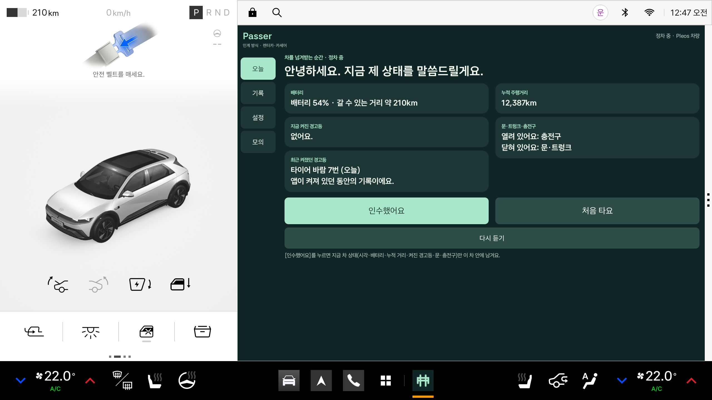
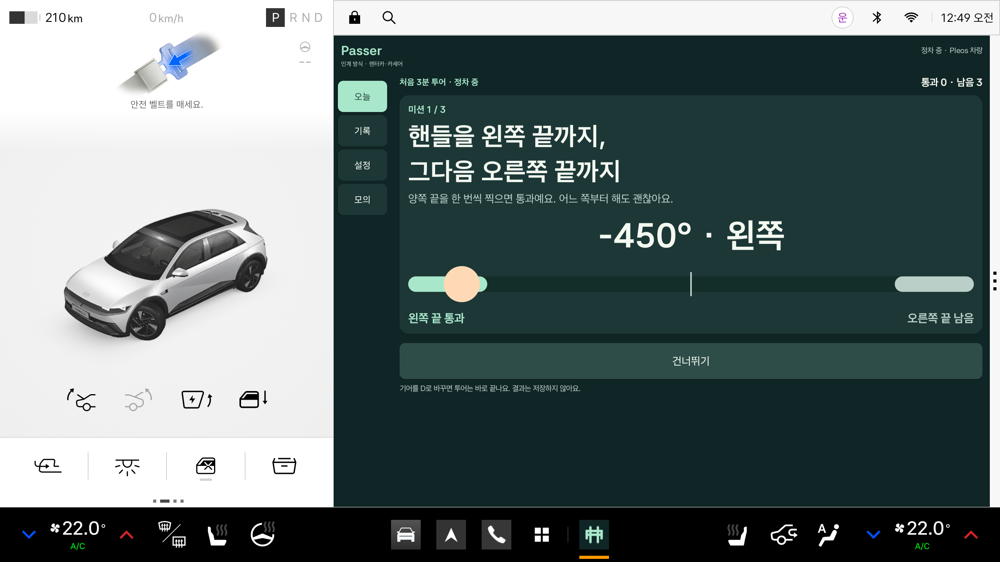
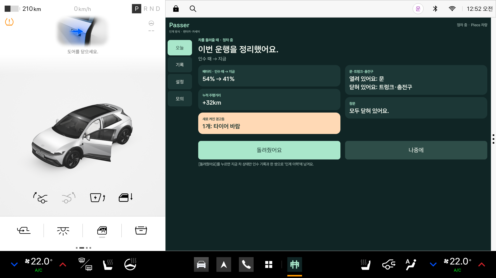
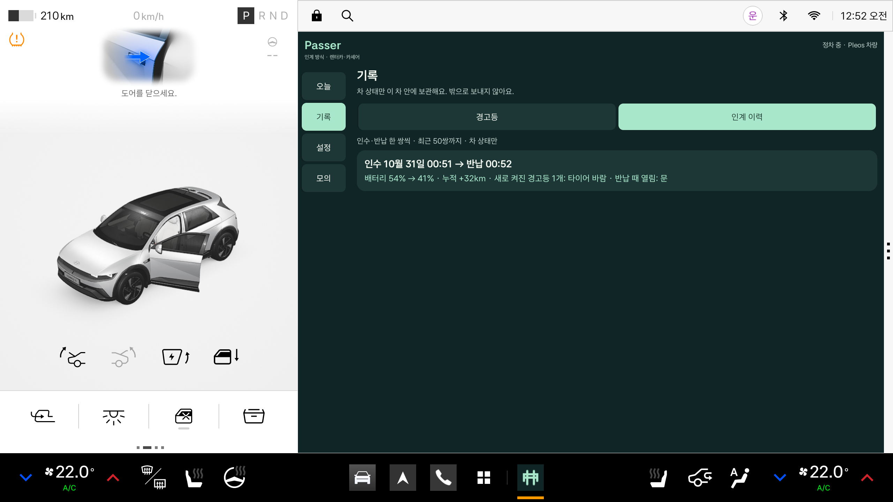
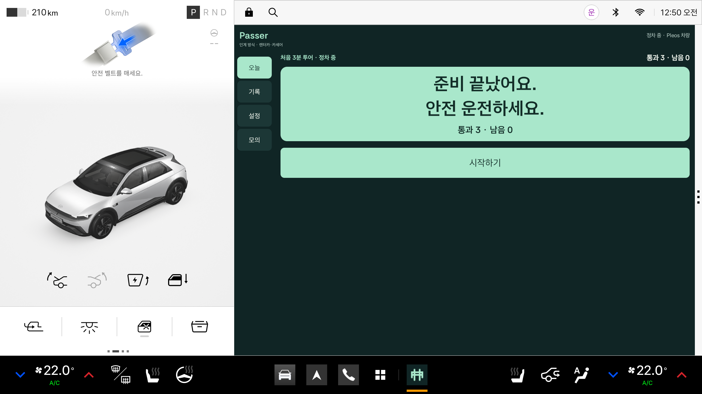
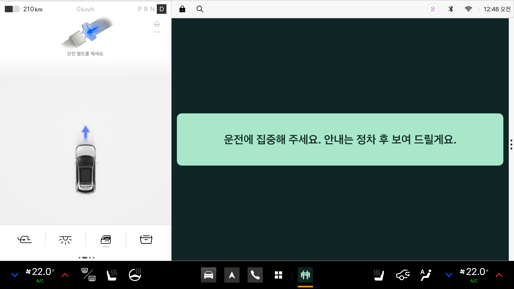

# Passer — 차를 넘겨받는 첫 3분

운전자가 바뀌는 순간, 차가 다음 사람에게 자기 상태를 30초로 인계하고, 실제 조작 미션으로 차에 익숙해지게 하며, 돌려줄 때 **차 상태만** 전후로 비교해 주는 Pleos 차량용 앱입니다.

> 2026 Pleos 앱 개발 챌린지 출품작 저장소입니다. 앱 이름 **Passer**("패서"로 읽습니다)는 차가 다음 운전자에게 자기 상태를 넘겨준다는 뜻입니다. 패키지명 `ai.gyeote.app`은 개발 초기 가제의 흔적이며 그대로 둡니다.

## 핵심 기능 3개

1. **인계 30초 (F1)** — 정차 중 운전석 문이 열렸다 닫히면 차가 1인칭으로 지금 상태를 말합니다: 배터리 %·갈 수 있는 거리, 지금 켜진 경고등과 최근 켜졌던 경고등(쉬운 말), 누적 주행거리, 문·트렁크·충전구. **[인수했어요]**를 누르면 그 순간의 차 상태만 차 안에 남깁니다.
2. **첫 3분 투어 (F2)** — **[처음 타요]**를 고르면 실제 조작으로 통과하는 미션 3개가 나옵니다: 핸들 왼쪽·오른쪽 끝까지, 브레이크 밟기, 방향지시등 켜기. 언제든 건너뛸 수 있고, 기어가 P를 벗어나면 바로 끝납니다. 결과는 저장하지 않습니다.
3. **돌려주기 카드 (F3)** — 주행 뒤 P에서 운전석 문을 열면 "인수 때 → 지금"을 보여 줍니다: 배터리 %, 누적 +km, 새로 켜진 경고등, 문·트렁크·충전구(창문은 차가 알려 줄 때만). 법인·택시·함께 쓰는 차 모드에서는 다음 사람에게 한 줄을 남길 수 있고(렌터카·카셰어 모드는 숨김), 법인·택시 모드에서는 운행 1건(출발·도착 km, 내비 목적지명이 있으면)을 월별 표에 적습니다.

사람을 평가하는 문장은 없습니다. 누가 어떻게 몰았는지는 저장하지 않고, 차 상태만 비교합니다.

## 시연 흐름 (렌터카·카셰어)

1. 모의 콘솔에서 경고등(타이어 공기압)을 켰다 끈다 → 차 안 경고등 기록 1건.
2. 기어 P에서 운전석 문 열림 → 닫힘 → 인계 카드와 음성 안내 → **[인수했어요]** 또는 **[처음 타요]**.
3. **[처음 타요]** → 콘솔에서 핸들 −450°·+450°, 브레이크, 방향지시등 → 미션마다 통과 → "준비 끝났어요. 안전 운전하세요."
4. 기어 D(주행 중에는 입력 없는 큰 문장 카드 1장만) → 콘솔에서 배터리 %·누적 km 변경 → 기어 P + 운전석 문 열림 → 돌려주기 카드 → **[돌려줬어요]**. 법인·택시 모드에서는 여기에 다음 사람에게 한마디와 운행 표가 더해집니다.
5. 기록 화면: 경고등 타임라인·정비사에게 보여주기 표 / 인계 이력 / 운행 표(법인·택시 모드).

## 화면

가로 2560×1440 에뮬레이터 캡처입니다.

| 인계 카드 (F1) | 투어 미션 1 (F2) |
|---|---|
|  |  |
| **돌려주기 카드 (F3)** | **인계 이력 (기록 화면)** |
|  |  |
| **투어 완료** | **주행 중 화면** |
|  |  |

## 구성

| 폴더 | 내용 |
|---|---|
| `app/` | Kotlin Android 앱 (패키지 `ai.gyeote.app`, 최소 Android 28). 설명·검증: [app/docs/README.md](app/docs/README.md) |
| `server/` | Node.js 데모 서버 + 폰 웹 (외부 패키지 없음, Node 20+). 지금은 보류 기능용이며 앱은 기본으로 연결하지 않습니다. 설명: [server/README.md](server/README.md) |
| `docs/` | 결정 기록 [decisions.md](docs/decisions.md), API 계약 [api_contract.md](docs/api_contract.md), SDK 메모 [pleos_sdk_notes.md](docs/pleos_sdk_notes.md), 개발 환경 [dev_env.md](docs/dev_env.md), 공개 전 감사 [repo_audit.md](docs/repo_audit.md) |

## 쓰인 Pleos SDK와 실측 제약

| 기능 | SDK 신호 | 에뮬레이터 |
|---|---|---|
| 탑승·하차 판정 | Gear P/D, Door(운전석) | 확인 |
| 배터리·거리 | EV 배터리 잔량, Odometer 누적·주행가능거리(미터로 와서 km로 바꿈) | 확인 |
| 경고등 현재·기록 | Safety `getTelltalesInfo` 3초 조회 | 확인 |
| 문·트렁크·충전구·창문 | Door(문·트렁크), EV 배터리 충전구, Window | 확인(창문은 0=닫힘, 열린 비율이 10% 미만이면 닫힘으로 보임) |
| 투어 미션 | 핸들 각도(SDK 부호가 반대라 앱에서 보정), 브레이크 페달 켬/끔, 방향지시등 | 확인 |
| 음성 안내 | Android 로컬 한국어 TTS | 이 에뮬레이터에 한국어 음성이 없어 요청까지만 확인 |
| 운행 표 목적지명 | NaviHelper 경로 시작 콜백 | 확인(내비 앱에서 안내를 시작하면 목적지명이 운행 표에 들어감). 단, 앱이 화면 뒤에서 Android에 의해 얼려진 동안은 콜백이 보류되고 앞으로 오면 전달됨. 콜백이 없으면 '—' |

- Vehicle 2.3.2, NaviHelper 3.0.5, 음성 SDK 3.3.1. 공식 Maven에서 받으며 **SDK 파일·API 원문은 이 저장소에 복사하지 않았습니다.**
- 에뮬레이터 이미지 v2.1.0(API 34, 전기차 설정)에서 확인했습니다. 실제 차량·백그라운드 동작은 검증 범위 밖입니다.
- **경고등 기록은 앱이 켜져 있던 동안의 것만** 남습니다. 앱이 꺼진 동안 켜진 경고등은 복원하지 않으며, 카드에도 그렇게 적습니다.
- 주행 중에는 입력 없는 큰 문장 카드만 표시하고, 인계·투어·돌려주기는 P에서만 나옵니다. 이는 주행 허용 심사를 받았다는 뜻이 아닙니다.

## 권한

- release: `CAR_DRIVE`, `CAR_SAFETY`, `CAR_DOORS`, `CAR_ENERGY`, `CAR_LIGHTS`, `CAR_SEATS`, `CAR_WINDOWS`, `NAVI_ROUTE`, `NAVI_ROUTE_SEARCH`, `INTERNET`. `CAR_ENERGY`·`CAR_LIGHTS`·`CAR_SEATS`·`CAR_WINDOWS`가 앱마켓 승인 목록에 있는지는 **아직 확인하지 않았습니다.**
- `PRIVATE_CAR_SAFETY`는 앱마켓 사전 승인이 필요해 **debug 빌드에만** 선언했습니다(음성 확인용 권한도 debug에만). release는 공개 조회(3초 간격)만 씁니다.

## 실행 방법

준비물: Node 20+, JDK 21, Android SDK(`local.properties`에 `sdk.dir`), Pleos 에뮬레이터. PowerShell 기준.

**앱 빌드·설치** (에뮬레이터 `emulator-5554`가 켜져 있어야 함)
```powershell
$env:JAVA_HOME = 'C:\Program Files\Android\Android Studio\jbr'
.\gradlew.bat test assembleDebug assembleRelease lintDebug --console=plain
& "$env:LOCALAPPDATA\Android\Sdk\platform-tools\adb.exe" -s emulator-5554 install -r app/build/outputs/apk/debug/app-debug.apk
& "$env:LOCALAPPDATA\Android\Sdk\platform-tools\adb.exe" -s emulator-5554 shell am start -n ai.gyeote.app/.MainActivity
```

모의 콘솔과 Virtual Console 사용법은 [app/docs/README.md](app/docs/README.md)를 보세요. 서버(`node server/src/index.js`)는 보류 기능을 다시 켤 때만 필요합니다.

## 테스트

```powershell
node --test server/test                  # 서버 계약 테스트
.\gradlew.bat test --console=plain       # 앱 단위 테스트 (Debug·Release)
```

| 대상 | 최근 결과 | 근거 |
|---|---|---|
| 앱 단위 테스트 | Debug 244 · Release 244, 실패 0 (2026-10-27) | [VERIFICATION_return.md](app/docs/VERIFICATION_return.md) |
| 서버 계약 테스트 | 56건 통과, 실패 0 (2026-10-27, `node --test server/test`) | 직접 실행 출력 |
| 에뮬레이터 통합 — F1 인계 | 17개 중 16개 통과(2026-10-27 재실행). 실패 1개: 한국어 TTS 음성 없음 | [VERIFICATION_handover.md](app/docs/VERIFICATION_handover.md) |
| 에뮬레이터 통합 — F2 투어 | 16개 중 16개 통과(TTS는 요청 로그까지만) | [VERIFICATION_tour.md](app/docs/VERIFICATION_tour.md) |
| 에뮬레이터 통합 — F3 돌려주기 | 12개 중 12개 통과(2026-10-27). 주행 중(D) 돌려주기 카드 0건 확인 | [VERIFICATION_return.md](app/docs/VERIFICATION_return.md) |

이전 콘셉트의 검증 기록: [VERIFICATION.md](app/docs/VERIFICATION.md), [VERIFICATION_car.md](app/docs/VERIFICATION_car.md), [VERIFICATION_edge.md](app/docs/VERIFICATION_edge.md), [VERIFICATION_polish.md](app/docs/VERIFICATION_polish.md). 에뮬레이터가 필요한 통합·캡처 도구(`app/tools/*.py`)는 해당 문서의 명령을 따릅니다.

## 개인정보 원칙

- **차 상태만 기록합니다.** 인수·반납 스냅샷에는 시각·배터리·누적 거리·경고등·문·트렁크·충전구·창문만 들어가고, 운전한 사람이나 운전 방식은 저장하지 않습니다.
- 기록은 **차 안(앱의 암호화 저장소)에만** 남고 서버로 보내지 않습니다.
- 투어 결과(통과·건너뜀·시간)는 저장하지 않습니다.
- 다음 사람에게 남기는 한마디는 한 줄(최대 60자)이며, 다음 사람이 인수하면 지웁니다. 인계 이력에는 넣지 않습니다.
- 설정의 **모두 지우기**로 경고등 기록·인계 이력·운행 표·마지막 인수 기록·한마디를 지웁니다.

## 보류 기능 (기능 스위치 꺼짐, 코드·테스트 보존)

이전 콘셉트에서 만든 폰 웹 '길 보내기', 도착 소식, 연결 숫자, 서버 동기화, 음성 메시지, 위치·타이어 수치 공유는 `Features.kt`의 스위치로 모두 꺼 두었습니다. 화면과 이동 경로에서 빠져 있고, 코드와 단위 테스트, `server/`의 계약 테스트는 그대로 둡니다. 서버는 다음 단계에서 인계 카드를 폰으로 보는 용도로 다시 쓸 수 있습니다(미정).

## 라이선스

**정하지 않음(모든 권리 보유).** Pleos SDK는 42dot의 라이선스를 따릅니다.

## AI 도구 사용

개발에 AI 코딩 도구(Claude Code, Codex 등)를 활용했다.
